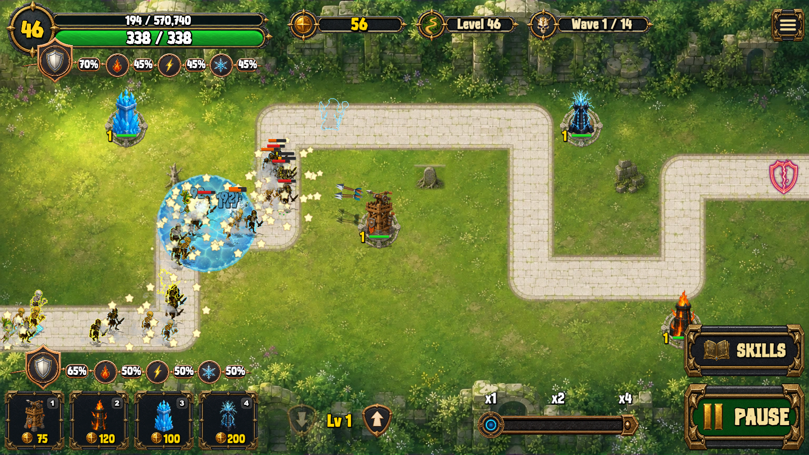
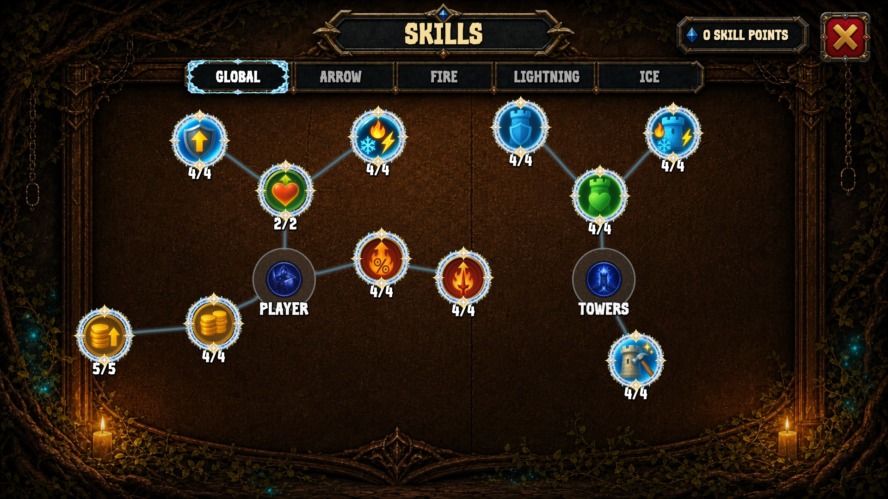
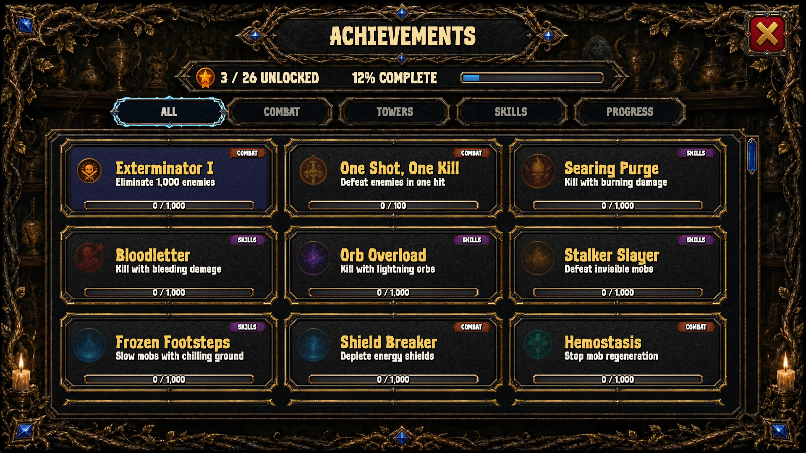
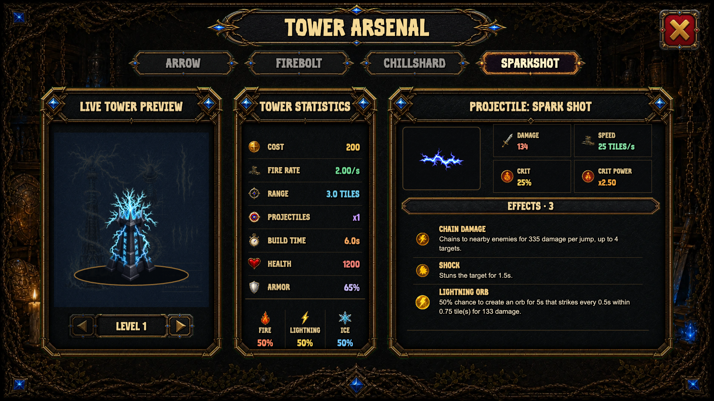
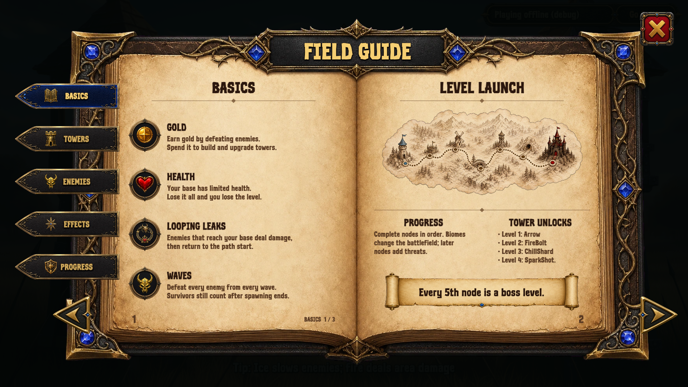
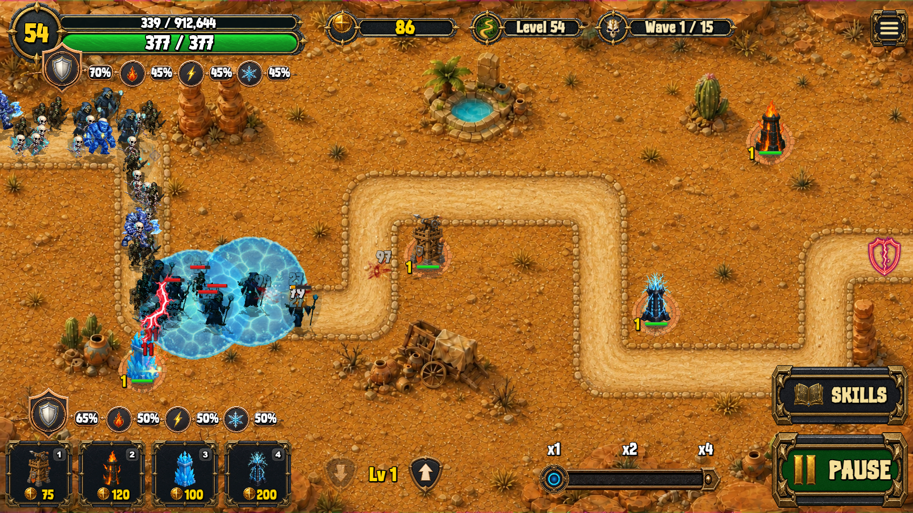
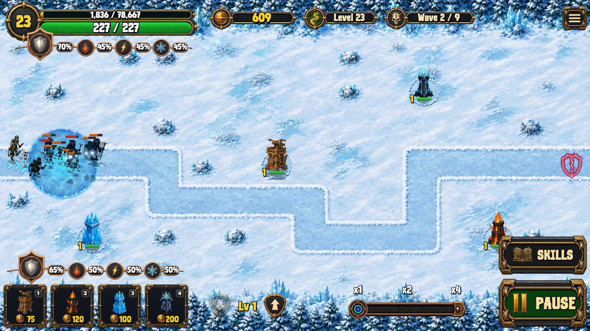
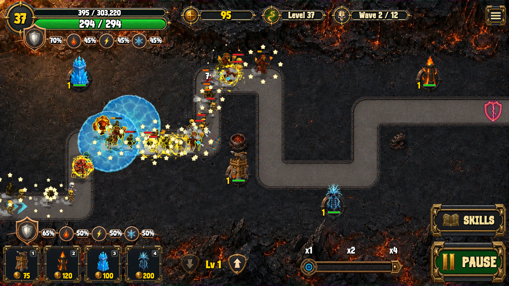

# **Tower Legends**

Tower Legends is a fast-paced tower defense game where the battlefield fights back. Build your defense, adapt your targeting, and survive escalating waves of enemies across a 100-level world map.

Enemies are not just cannon fodder: many can buff each other, some can attack your towers, and boss mobs can make tactical decisions to either destroy your setup or rush your base.

## **What Makes It Fun**

- **4 distinct tower classes:** Arrow, FireBolt, ChillShard, and SparkShot, each with unique damage types and effects.
- **Real tactical choices:** Switch targeting priorities (Closest, Weakest, Strongest, First) to counter different wave compositions.
- **Progressive challenge:** Advance across 100 levels on a world map with 4 biomes.
- **Boss encounters:** Face a boss every 5th level with dedicated boss AI and high-pressure fights.
- **Deep progression:** Earn player XP and levels, unlock a multi-category skill tree (Global, Arrow, Fire, Lightning, Ice), and pursue long-term achievements.
- **Meta goals that matter:** Chase layered achievements.
- **Pre-level strategy layer:** Review the enemy roster and buffs before each run, plus buff rerolls with meaningful risk/reward (paid rerolls reduce XP gain for that level).
- **Run-changing loot drops:** Gain temporary power spikes like damage boosts, rapid fire, tower fortification, and emergency repairs.
- **Performance and replayability-focused design:** Experience a different path for every level and robust combat systems.

## **Core Gameplay Loop**
- Pick a level on the world map.
- Review enemy buffs and roster before launch.
- Build your setup, start waves, and react in real time.
- Upgrade, retarget, and sell towers as pressure rises.
- Beat all waves, collect rewards, and push to the next challenge.

## **Playstyle Summary**

Tower Legends is built for players who enjoy:
- Meaningful moment-to-moment decisions.
- Visible build progression.
- Tough but readable difficulty scaling.

If you like tower defense games with stronger combat depth and boss pressure, Tower Legends is designed for you.

Screenshots:

## **Privacy**

Read the [Privacy Policy](privacy-policy.md).
